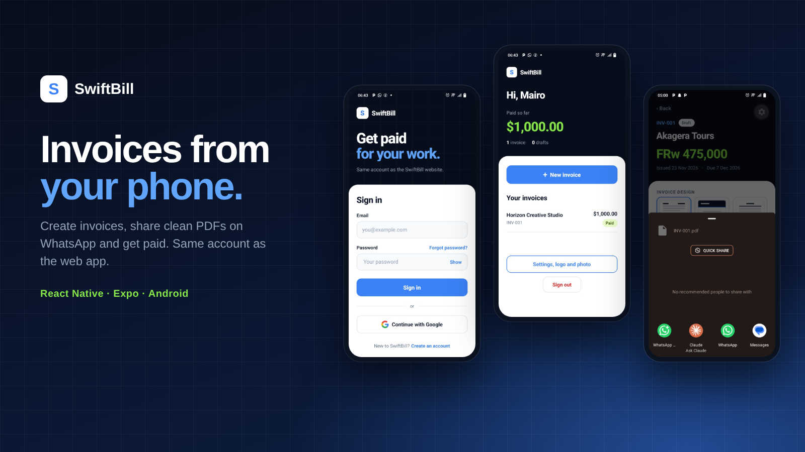
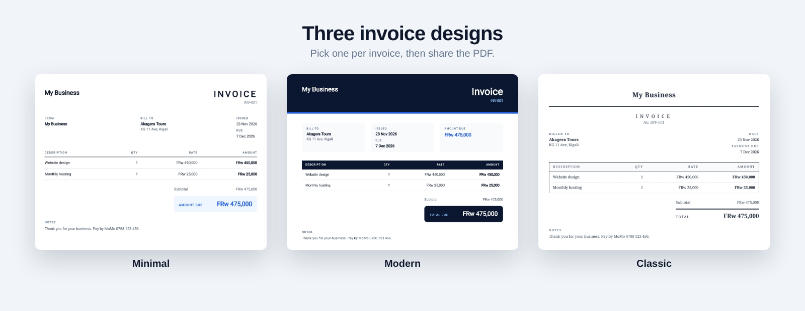

# SwiftBill Mobile

> **Invoices from your phone.** Create an invoice, share a clean PDF on WhatsApp, and get paid.



SwiftBill Mobile is the Android app for [SwiftBill](https://github.com/MairoPedroIsaac/swiftbill), a full-stack invoicing app for freelancers and small businesses. It uses the **same account and the same data** as the web app, so an invoice created on the phone shows up on the website, and the other way round.

---

## 📲 Download

**[Download the Android app (APK)](https://github.com/MairoPedroIsaac/swiftbill-mobile/releases/latest)**

1. Open the link on an Android phone and download `SwiftBill.apk`.
2. Open the file. If Android asks, allow installs from your browser.
3. Sign in with Google or with your SwiftBill email and password.

No account yet? Tap **Create an account** on the sign in screen, or sign up on the [website](https://swiftbill-swart.vercel.app/).

---

## 🔗 Related

| | |
| --- | --- |
| 🌐 **Web app (live)** | [swiftbill-swart.vercel.app](https://swiftbill-swart.vercel.app/) |
| 💻 **Web app source** | [MairoPedroIsaac/swiftbill](https://github.com/MairoPedroIsaac/swiftbill) |
| 📱 **Mobile app source** | this repository |

---

## ✨ Features

### 🔐 Sign in, same account as the web
* Email and password sign in
* **Continue with Google**, through the web app's Google sign in, then straight back into the app with a secure deep link (`swiftbillmobile://`)
* Session stored in the phone's encrypted storage (Expo SecureStore), so you stay signed in

### 📊 Home
* "Paid so far" total, invoice and draft counts
* Your latest invoices with status badges (Draft, Sent, Paid)
* Refreshes every time you come back to the screen

### 🧾 Create invoices
* Pick a saved customer or type a new one
* Add items, or tap a saved item to reuse its name and price
* 12 currencies, including **RWF (FRw)**, USD, EUR, GBP and KES, formatted exactly like the web app
* Due date shortcuts, tax, notes and a live total
* Invoice numbers (INV-001, INV-002...) come from the server, so web and mobile never clash

### 📄 Share as PDF
* Three invoice designs, **Minimal**, **Modern** and **Classic**, matching the web app
* Preview before sending
* Share the real PDF file (named `INV-001.pdf`) to WhatsApp, email or any app
* Mark invoices as paid, sent or unpaid



### ⚙️ Settings
* **Your account:** profile photo (add, change, remove) and name
* **Your business:** business logo, name, billing email, phone, address and invoice number prefix, printed on every invoice
* Photos are resized and compressed on the phone before upload

---

## 🛠 Tech Stack

| Technology | Purpose |
| --- | --- |
| **React Native + Expo (SDK 58)** | Cross-platform mobile app |
| **Expo Router** | File-based navigation with typed routes |
| **TypeScript** | Type-safe code across the app |
| **Expo SecureStore** | Encrypted storage for the sign in token |
| **Expo WebBrowser + Linking** | Google sign in and deep link back to the app |
| **Expo Print + Sharing + FileSystem** | HTML to PDF, then native share sheet |
| **Expo ImagePicker + ImageManipulator** | Logo and profile photo upload |
| **EAS Build** | Android APK builds in the cloud |
| **Next.js API (web repo)** | Shared backend, PostgreSQL and Prisma |

---

## 🧠 How it works

The web app uses NextAuth with browser cookies, which a phone app cannot use. So the web API got a small mobile layer:

```text
Email sign in   ->  POST /api/mobile/login       ->  signed token
Google sign in  ->  /mobile-auth (web, Google)   ->  swiftbillmobile://auth?token=...
Every request   ->  Authorization: Bearer <token>
```

* The token is signed with the same secret as the web sessions and expires after 60 days.
* The existing API routes accept **either** a web cookie **or** a mobile token, so both apps share one backend and one database.
* The app only redirects back to its own link scheme, so the token cannot be sent to another site.

---

## 📁 Project Structure

```text
src/
  app/                  Screens (Expo Router)
    sign-in.tsx         Email + Google sign in
    auth.tsx            Google sign in return
    home.tsx            Totals and recent invoices
    new-invoice.tsx     Invoice builder
    invoice/[id].tsx    Invoice detail, PDF share, status
    settings.tsx        Account and business settings
  features/             Larger screens (Settings)
  components/           Logo, status bar shade
  lib/                  API client, auth, money, currencies, PDF templates
  constants/theme.ts    Brand colours and sizes
```

---

## 🚀 Run it locally

You need Node.js and the **Expo Go** app on your phone.

```bash
git clone https://github.com/MairoPedroIsaac/swiftbill-mobile.git
cd swiftbill-mobile
npm install
npx expo start
```

Open Expo Go on your phone and open the server shown in the terminal (phone and laptop on the same Wi-Fi).

> Google sign in needs the installed app (it uses the `swiftbillmobile://` link). In Expo Go, use email sign in.

### Build the Android app

```bash
npx eas-cli@latest login
npx eas-cli@latest build -p android --profile preview
```

The `preview` profile builds an installable APK. The `production` profile builds an AAB for Google Play.

---

## 📌 Status

**Portfolio project.** Built and tested on a real Android phone: sign in (email and Google), invoices, PDF sharing on WhatsApp, all three designs, and settings.

Possible next steps: Google Play release, edit and delete invoices on mobile, offline drafts.

---

Built by **Mairo Pedro Isaac** · [Web app](https://github.com/MairoPedroIsaac/swiftbill) · [Live site](https://swiftbill-swart.vercel.app/)
